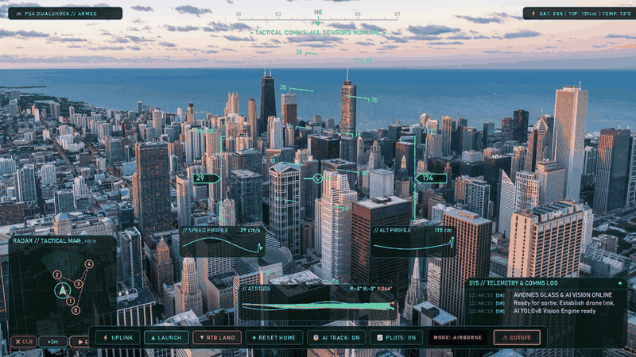
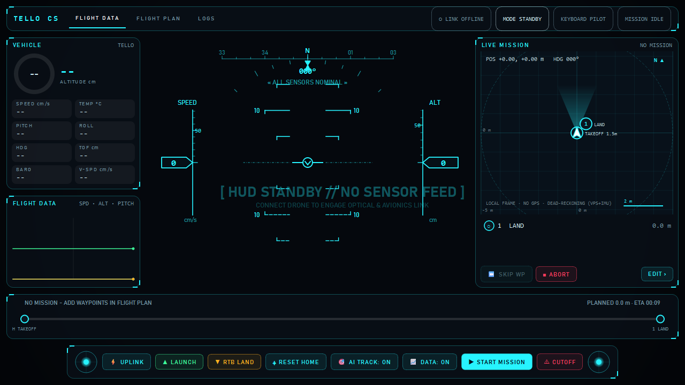
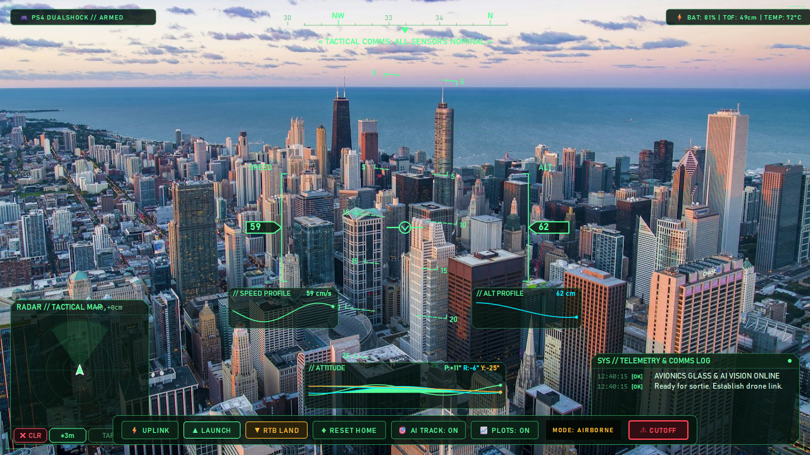
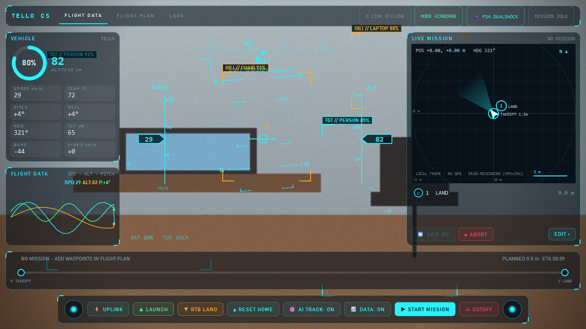
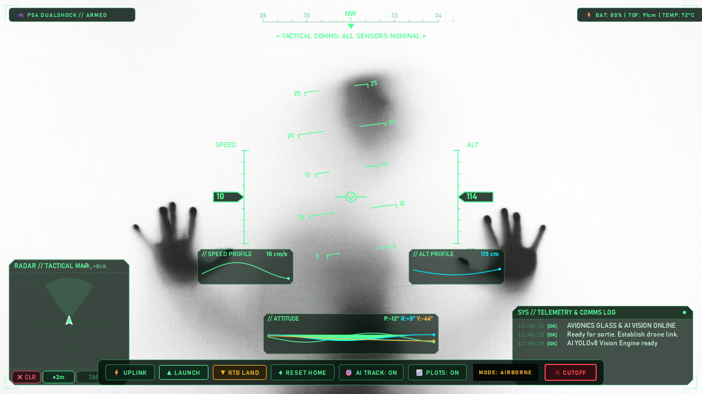
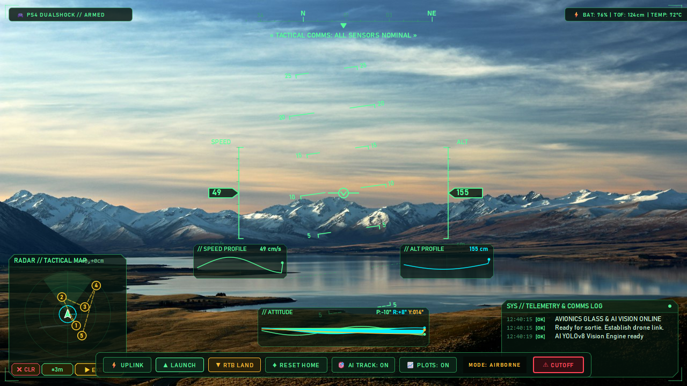
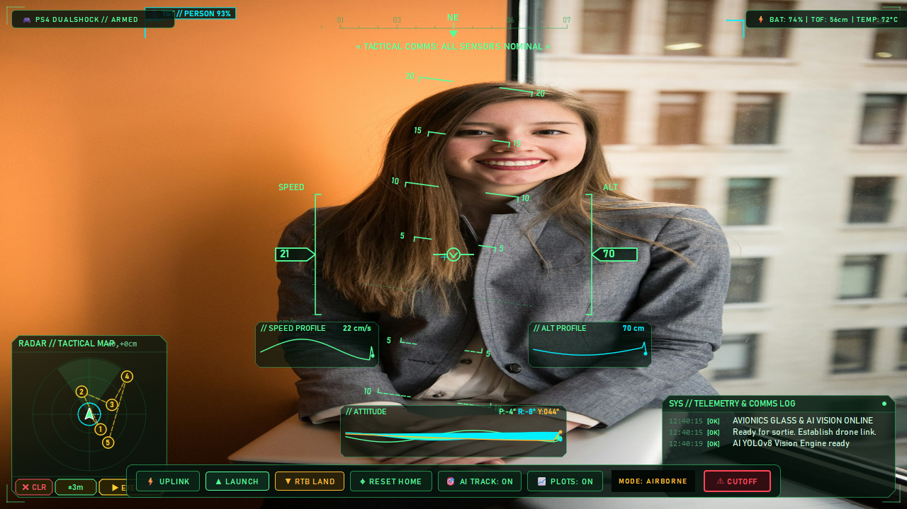

# 🚁 Tello Control Station — Modern Aerospace Glass Cockpit & Tactical HUD

A next-generation desktop Ground Control Station (GCS) for the **Ryze Tello** (Non-EDU) drone built with **Python**, **PySide6 (Qt6)**, **OpenCV**, and **YOLOv8**.

Designed with an **Ace Combat / Modern Fighter Jet Glass Cockpit** aesthetic, featuring real-time AI object/person tracking, a live flight-data trace, and a Mission-Planner-style **waypoint planner with autonomous mission execution and live progress tracking**.

> **UI v2 (glass cockpit + mission control).** The app now has three pages: **FLIGHT DATA** (video + fighter HUD + live mission map), **FLIGHT PLAN** (waypoint planner) and **LOGS**. The screenshots/GIF below still show the previous UI until `scripts/gen_screenshots.py` is re-run.

---

## 🎬 Live Demo



---

## 📸 Screenshots

| HUD Standby | Airborne Flight HUD |
|:-----------:|:-------------------:|
|  |  |

| AI Object & Person Detection | Attitude Sparkline Graphs |
|:---------------------------:|:------------------------:|
|  |  |

| Tactical Radar + Waypoint Planner | Person Target Lock |
|:---------------------------------:|:------------------:|
|  |  |

---

## ⚡ Key Features

- **🛩️ Full-Bleed Glass Cockpit + Fighter HUD**:
  - Translucent glass panels with glowing corner brackets over the FPV video (cyan theme, see `src/ui/theme.py`).
  - Dynamic rotating & shifting Pitch Ladder (solid bars for positive, dashed for negative) and a bank scale.
  - Center Aircraft Watermark flight path reticle (`-\v/-`).
  - **Scrolling** Speed tape (cm/s) and Altitude tape (cm) with readout chevrons.
  - Top Horizontal Linear Heading Compass Ribbon with numeric heading.
  - Mission line (`WP 2/5  DIST 2.8 M  ETA 00:28`), radio banner and flashing **master caution** (low battery / geofence breach).

- **🎯 Real-Time AI Object & Human Tracking (YOLOv8)**:
  - Powered by asynchronous background YOLOv8 inference with zero video latency.
  - **Person Target Lock**: Cyan/Emerald combat tracking brackets with `[ 👤 TGT // PERSON 94% ]` and crosshairs.
  - **Object Target Lock**: Tactical amber brackets with `[ 🎯 OBJ // <LABEL> ]` for everyday items (chairs, bottles, laptops, etc.).
  - One-click toggle (`[🎯 AI TRACK: ON/OFF]` or hotkey `O`).

- **📊 FLIGHT DATA card**:
  - One rolling trace with 3 series: speed (cm/s), altitude (cm) and pitch, with live readouts.
  - Vehicle card: battery ring, altitude, speed, temperature, pitch/roll/heading, ToF, barometer, vertical speed.
  - Toggle with `[📈 DATA: ON/OFF]` or hotkey `P`.

- **🗺️ Mission Planner (FLIGHT PLAN page) — no GPS, local metric frame**:
  - Big map (grid in metres, anchored at Home) with geofence ring. **Click** = add waypoint, **drag** = move, **right-click** = delete, wheel = zoom, middle-drag = pan.
  - ArduPilot-Mission-Planner-style **waypoint table**: `# · CMD · X · Y · ALT · PARAM · DIST · HDG`, editable cells, per-row command (`GO`, `ROTATE`, `HOVER`, `FLIP`, `LAND`).
  - **Patterns**: Orbit, Square, Grid scan. Save/Load missions as JSON.
  - Altitude profile plus estimated path length, time and battery use (rough planning numbers).
  - `▶ START MISSION` runs the plan **from the PC** via Tello SDK motion commands (`takeoff`, `up/down`, `forward/back/left/right`, `cw/ccw`, `flip`, `land`), converted to the drone's body frame. It is not uploaded to the drone.
  - The plan is locked while a mission is running; waypoints outside the geofence block the start.

- **📡 Live Mission tracking (FLIGHT DATA page)**:
  - Live map with the drone, FOV cone and breadcrumb trail. Waypoints show **✓ done / ▶ active / ○ pending**, completed path is green.
  - Progress strip `H → LAND` with remaining distance and ETA; `SKIP WP` / `ABORT` controls (they take effect between commands).
  - Position is **dead-reckoned** (IMU + vision velocity), so it drifts over time. Use `⌖ RESET HOME` to re-anchor.

- **🎮 Dual-Input: Keyboard + Gamepad Controller Support**:
  - Full support for **PlayStation (PS4 / PS5 DualSense)**, **Nintendo Switch Pro Controller**, and **Xbox** controllers via `pygame`.
  - Standard Drone Mode 2 (Left stick: Throttle/Yaw, Right stick: Pitch/Roll).
  - Action buttons: Takeoff, Land, Flip, Hover brake, Emergency engine cutoff.
  - Global Key Event Filter: Ensures keyboard controls (`WASD`, arrow keys) are never blocked by button focus.

---

## 🎮 Flight Controls

### Keyboard Mapping
| Key | Action |
|---|---|
| `W` / `S` | Pitch Forward / Backward |
| `A` / `D` | Roll Left / Right |
| `↑` / `↓` | Throttle Up / Down (Altitude) |
| `←` / `→` | Yaw CCW / CW |
| `Space` | Active Hover Brake (Zero RC) |
| `T` | Auto Takeoff |
| `L` | Auto Land |
| `Esc` | Emergency Engine Cutoff |
| `P` | Toggle Flight Data card |
| `O` | Toggle AI Object / Person Tracking |
| `M` | Switch FLIGHT DATA ↔ FLIGHT PLAN |

Keys are not intercepted while typing in a field or navigating the waypoint table.

### Gamepad Mapping (Mode 2)
| Axis / Button | Function |
|---|---|
| Left Analog Stick | Vertical: Throttle (Up/Down) · Horizontal: Yaw (Turn) |
| Right Analog Stick | Vertical: Pitch (Fwd/Back) · Horizontal: Roll (Left/Right) |
| `Cross / A` | Auto Takeoff |
| `Circle / B` | Auto Land |
| `Triangle / Y` | Flip Forward |
| `Square / X` | Active Hover Brake |
| `L1 / LB` | Emergency Cutoff |
| `R1 / RB` | Speed Boost Toggle (60% ➔ 90%) |

---

## 🛠️ Installation & Setup

### Prerequisites
- Python 3.10+ (tested on Python 3.13)
- Windows 10 / 11

### 1. Clone & Set Up Environment
```bash
git clone https://github.com/HaikalBaiqunni/TelloControlStation.git
cd TelloControlStation

# Create virtual environment
python -m venv .venv
.\.venv\Scripts\activate

# Install dependencies
pip install -r requirements.txt
```

### 2. Connect to Tello Wi-Fi
1. Power on your Ryze Tello drone.
2. Connect your PC's Wi-Fi adapter (or secondary USB Wi-Fi dongle) to the drone's SSID (e.g. `TELLO-XXXXXX`).

> **Dual Wi-Fi Tip**: If you need internet while flying, connect your primary Wi-Fi to your router and use a USB Wi-Fi dongle (e.g. TP-Link Nano) exclusively for the Tello AP. The GCS will send UDP commands through the correct interface automatically.

### 3. Launch the Cockpit
```bash
python main.py
# Or run using the launcher script:
.\run.bat
```
4. Click **`⚡ UPLINK`** in the bottom Action Deck to connect and initialize the video stream!

---

## 🗂️ Project Architecture

```
TelloControlStation/
├── main.py                          # Application entry point
├── requirements.txt                 # Dependencies (PySide6, opencv, numpy, pygame, ultralytics)
├── run.bat                          # One-click Windows launcher
├── assets/
│   └── screenshots/                 # UI screenshots & animated demo GIF
├── scripts/
│   └── gen_screenshots.py           # Generates all README screenshots & demo.gif
├── src/
│   ├── drone/
│   │   ├── tello_sdk.py             # UDP Socket wrapper for Tello SDK 1.3
│   │   ├── state_parser.py          # Real-time state string parser (DroneState)
│   │   ├── video_stream.py          # H.264 UDP OpenCV decoder thread
│   │   ├── mission.py               # Waypoint dataclass + path/time estimates (no Qt)
│   │   ├── mission_planner.py       # Autonomous mission executor (TAKEOFF/GO/ROTATE/HOVER/FLIP/LAND)
│   │   ├── pose.py                  # Dead-reckoned local position tracker
│   │   └── object_detector.py       # Asynchronous YOLOv8 AI object & person detector
│   ├── input/
│   │   └── gamepad_handler.py       # Pygame joystick input handler (PS4/Switch/Xbox)
│   ├── ui/
│   │   ├── main_window.py           # MainWindow: pages, drone/mission wiring, input
│   │   ├── pages.py                 # FlyPage, PlanPage, LogsPage
│   │   ├── mission_model.py         # Shared Qt mission model (edits, patterns, progress)
│   │   ├── theme.py                 # Palette, fonts, global stylesheet
│   │   └── widgets/
│   │       ├── glass.py             # GlassPanel (translucent card)
│   │       ├── topbar.py            # Tabs + status chips
│   │       ├── camera_widget.py     # Video canvas + AI lock brackets
│   │       ├── fighter_hud.py       # Fighter HUD (ladder, bank scale, scrolling tapes)
│   │       ├── vehicle_panel.py     # Battery ring + telemetry cells
│   │       ├── mission_map.py       # Metric mission map (edit + live progress)
│   │       ├── waypoint_table.py    # Mission-Planner style waypoint grid
│   │       ├── mission_widgets.py   # Progress strip, status list, altitude profile
│   │       ├── flight_log.py        # Glass telemetry & comms log panel
│   │       └── sparkline_widget.py  # Rolling flight-data trace
│   └── utils/
│       └── logger.py                # Thread-safe flight event logger
```

---

## 📄 License
MIT License. Built for drone hobbyists, FPV enthusiasts, and robotics tinkerers.
